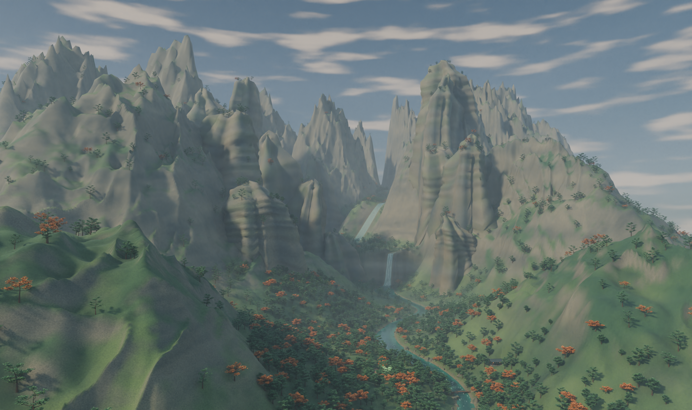

# 苍云界 · 万青山溪谷 2026-11-12

[Blender 源件](Cangyun_Wanqing.blend) 从 [万青山小屋核心区](../wanqing-core-study-2026-09-07-01/wanqing-core-study-2026-09-07-01.blend) 扩展为 2.50 × 2.89 公里的米制场景。主脊、支脊和扎入坡面的岩壁围出溪谷。溪水贯穿缓滩、深潭和两级显眼的跌水，林地按坡度和疏密分布。镜头从山谷全景落到屋前人眼高度，门口、床铺和洗涤处仍可辨认。



[屋前人眼高度](Preview/Wanqing_hut.png) · [上游跌水](Preview/Wanqing_waterfall.png)

小屋保留原破损屋顶、门窗、家具及四个交互标记。新增林缘步道、木桥和望溪亭。山谷地貌、亭桥和秋色属于本轮场景设计，苍云界其余区域仍待制作。

## 复现与验证

[制作脚本](build_valley.py) 在 Blender 5.2.1 中用后台 build 模式读取小屋核心区，用 render 模式重开新场景并以 Cycles Metal 渲染。独立重开检查对比了小屋几何、地基接触和原局部路线高程，核查了地形分块接缝、河床与水面间隙、岩壁接地及桥头高度。数值、哈希和图像尺寸见 [Verification.json](Verification.json)。角色实走、运行时碰撞和性能仍待验证。

从仓库根目录运行，输出目录需已存在。

```sh
/Applications/Blender.app/Contents/MacOS/Blender -b --factory-startup --disable-autoexec --python-exit-code 1 \
  --python Docs/Art/World/Cangyun/Authoring/Candidates/wanqing-valley-2026-11-12/build_valley.py -- \
  render --view valley --samples 52 --image /tmp/Wanqing_valley.png
```
